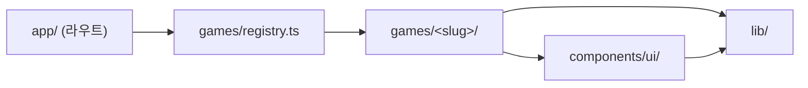

# 아키텍처

소규모 프로젝트를 전제로 **최소한의 레이어**만 둔다. 추상화는 실제로 두 번 이상 필요해졌을 때 도입한다.

## 실행 환경

- 진행자 노트북(데스크톱 브라우저, 1920×1080 기준) → 프로젝터/TV 출력
- 참가자는 각자 휴대폰으로 사이트에 접속해 **이름을 한 번 등록**하면(아래 "참여자 신원"), 이후 로그인 없이 어느 게임에서든 같은 사람으로 이어진다
- 게임 자체는 기본적으로 서버 상태 없이 진행자 노트북 한 대로 동작한다. 참가자 휴대폰과 상태를 공유해야 하는 게임(마니또 미션)만 서버 상태를 쓴다 (아래 "서버 상태" 참고)
- 모든 게임 페이지는 빌드 시 정적으로 생성된다 (`generateStaticParams`). `cacheComponents` 환경이라 `dynamicParams`는 쓸 수 없으며, 미등록 slug는 `notFound()`로 not-found UI를 보여준다 (스트리밍 특성상 상태 코드는 200일 수 있음)

## 디렉터리 구조

```text
yos-game/
├── app/                      # 라우팅 전용 (얇게 유지)
│   ├── layout.tsx            # 루트 레이아웃 (lang="ko", 전역 배경)
│   ├── page.tsx              # 홈: 레지스트리 기반 게임 목록
│   ├── not-found.tsx         # 404 화면 (미등록 slug 포함)
│   ├── globals.css           # Tailwind 진입점 + 테마 토큰
│   ├── games/[slug]/page.tsx # 게임 공통 셸: 헤더 + 레지스트리에서 찾은 게임 렌더
│   ├── join/page.tsx         # 참가자명 입력·등록 (등록 전에는 이 화면만 볼 수 있음)
│   ├── host/page.tsx         # 사회자 전용 메뉴 (사이트 설정 on/off)
│   ├── api/settings/         # 사이트 설정 API → lib/settings/server/ 호출
│   ├── api/participants/     # 참여자 등록 API → lib/participants/server/ 호출
│   └── api/<slug>/…/route.ts # (서버 상태 게임만) 얇은 Route Handler → games/<slug>/server/ 호출
├── games/                    # 게임 모음 (기능 단위 폴더)
│   ├── types.ts              # GameMeta 타입
│   ├── registry.ts           # 게임 등록부 (SSOT)
│   └── <slug>/               # 게임 1개 = 폴더 1개
│       ├── meta.ts           # 제목·설명·인원 등 메타데이터
│       ├── logic.ts          # 순수 함수: 규칙, 상태 전이 (React 의존 X)
│       ├── Game.tsx          # "use client" 게임 UI (진입 컴포넌트, default export)
│       ├── client.ts         # (서버 상태 게임만) API 호출 + 폴링 훅
│       └── server/           # (서버 상태 게임만) 저장소·요청 처리. 클라이언트에서 import 금지
├── components/ui/            # 2개 이상 게임이 쓰는 공용 UI (Button 등)
├── components/participant/   # 참여자 등록 화면, 상단 신원 띠
├── lib/
│   ├── cn.ts                 # 공용 유틸
│   ├── hooks/                # 공용 훅 (useStoredValue: local/sessionStorage 를 React 상태처럼)
│   ├── participants/         # 참여자 신원: shared(타입) · client(훅/API 호출) · server/(저장소·핸들러)
│   └── server/               # 서버 전용 공용: Redis 클라이언트, 사회자 비밀번호 확인
├── e2e/                      # Playwright 테스트 (*.spec.ts)
├── docs/                     # 하네스 문서
└── public/                   # 정적 에셋 (게임별 에셋은 public/games/<slug>/)
```

## 의존 방향



- 화살표 반대 방향 import 금지 (예: `components/`가 `games/`를 import 하면 안 됨)
- `games/<a>/`가 `games/<b>/`를 import 하는 것 금지 → 공용 코드는 `components/` 또는 `lib/`로 이동
- 모든 import는 `@/` 절대 경로 사용 (같은 게임 폴더 내부는 `./` 상대 경로 허용)

## 서버/클라이언트 컴포넌트 경계

- `app/` 아래 페이지·레이아웃은 **서버 컴포넌트**로 유지 (메타데이터, 정적 생성)
- 상호작용이 있는 게임 UI(`Game.tsx`)와 그 하위만 `"use client"`
- `logic.ts`는 어느 쪽에서도 쓸 수 있는 순수 TS

## 상태 관리

- 게임 상태는 각 `Game.tsx`의 `useState` / `useReducer`로 로컬 관리 (전역 상태 라이브러리 없음)
- 상태 전이 함수는 `logic.ts`에 두어 `useReducer`의 reducer로 그대로 쓸 수 있게 한다
- 새로고침 후에도 유지해야 하는 값(점수판 등)만 `localStorage` 사용 — 키는 `yos-game:<slug>:<key>` 형식

## 참여자 신원 (사이트 공용)

로그인 없이 "같은 사람이 같은 정보를 보게" 하기 위한 최소 장치다.

- **미리 정한 명단은 없다.** 참가자가 직접 입력한 이름이 곧 명단이다. 이름은 앞뒤 공백을 지우고 12자 이하로 제한한다(`lib/participants/shared.ts`의 `normalizeName`·`validateName`)
- **등록 전에는 아무 화면도 볼 수 없다.** 루트 레이아웃의 `ParticipantGate`가 신원이 없는 기기를 `/join?next=<원래 주소>`로 보내고, 등록하면 원래 가려던 화면으로 돌려보낸다. 신원이 기기(`localStorage`)에만 있어 판단은 브라우저에서 하며, 서버 API 의 권한 확인은 따로 토큰으로 한다
- 참가자는 `/join`에서 이름을 직접 입력한다. 기기에 임의 토큰이 `localStorage`(`yos-game:participant`)로 저장되고, 서버 Redis 해시(`yos-game:participants`)에 이름 → 토큰이 기록된다. 같은 이름은 한 기기만 차지할 수 있다(`HSETNX`, 이미 쓰는 이름이면 409). 이름을 바꾸면 새 이름을 먼저 등록한 뒤 이전 이름을 푼다
- 이후 모든 페이지 상단 띠(`ParticipantBar`)에 이름이 보이고, 게임은 `useParticipantIdentity()`로 신원을 읽어 `x-participant-token` 헤더로 서버에 보낸다. 서버는 토큰으로 이름을 확정하므로 본인 것만 내려 줄 수 있다
- **이름 변경은 기본 꺼짐**이다. 사회자가 `/host`(상단의 "🔒 사회자 메뉴")에서 "참가자 이름 변경 허용"을 켠 동안에만 상단 "변경" 링크가 보이고 `/join`에서 바꿀 수 있다. 화면 우회를 막으려고 서버(`POST`로 다른 이름 등록, 참가자 스스로의 `DELETE`)도 같은 설정을 확인해 403 을 돌려준다. 사회자의 해제는 항상 가능하다
- 사이트 설정(`lib/settings/`)은 Redis 문자열 하나(`yos-game:settings`)에 JSON 으로 저장하며, 읽기는 누구나·쓰기는 사회자 비밀번호가 필요하다. 사회자 비밀번호는 탭에만 기억하며(`lib/host/client.ts`) 게임의 사회자 화면과 공유한다
- 휴대폰 교체 등으로 막히면 사회자가 게임의 사회자 화면에서 "기기 초기화"로 해제한다. 등록이 풀린 기기는 다음 폴링에서 안내를 받고 다시 등록한다
- 브라우저 데이터 삭제·시크릿 모드에서는 토큰이 사라지므로 사회자 해제가 필요하다

## 서버 상태 (기기 간 공유가 필요한 게임만)

참가자가 각자 휴대폰으로 접속해 같은 게임을 봐야 할 때만 서버 상태를 둔다. 현재는 마니또 미션이 유일하다.

- **저장소**: Upstash Redis(`lib/server/redis.ts`). Vercel Marketplace 연동으로 붙이며 `KV_REST_API_URL`/`KV_REST_API_TOKEN`(또는 `UPSTASH_REDIS_REST_*`) 환경 변수를 읽는다. 변수가 없으면 서버 메모리 저장소로 대체되어 로컬 개발·E2E는 네트워크 없이 돌아간다 (`.env.example` 참고)
- **구조**: `app/api/<slug>/…/route.ts`는 요청을 `games/<slug>/server/handlers.ts`로 넘기기만 한다. 핸들러는 요청 검증 → `logic.ts` 순수 함수로 상태 전이 → `server/store.ts`에 기록 → 응답 순서로 동작한다
- **동기화**: 서버 푸시 없이 클라이언트가 3초 간격으로 다시 읽는다 (`games/<slug>/client.ts`의 `usePolledState`). 동작(POST)의 응답으로 자기 화면은 즉시 갱신한다
- **동시 쓰기**: 여러 기기가 동시에 쓰는 값(확인 여부 등)은 Redis 해시의 필드 단위로 써서 덮어쓰기를 피한다. 한 사람(사회자)만 바꾸는 값은 JSON 하나로 저장한다
- **권한**: 사회자 동작은 `x-host-pin` 헤더의 비밀번호로 구분한다(`lib/server/hostPin.ts`, `HOST_PIN` 환경 변수, 없으면 기본값 `9409`). 참여자는 `x-participant-token`으로 구분하며 본인 것과 공개된 정보만 내려 준다
- **클라이언트 경계**: `games/<slug>/server/`와 `lib/*/server/`, `lib/server/`는 Route Handler에서만 import 한다. 클라이언트가 쓰는 타입은 `import type`으로만 가져온다

## 하지 않는 것 (현 단계)

- 위 "서버 상태" 범위를 넘는 백엔드(Server Action, 다른 DB/외부 API, 인증)
- 상태 관리 라이브러리, CSS-in-JS, UI 컴포넌트 라이브러리
- 단위 테스트 프레임워크 (필요해지면 Vitest 도입을 검토)

이 목록의 항목이 필요해지면 문서를 먼저 갱신하고 사용자와 합의한다.
