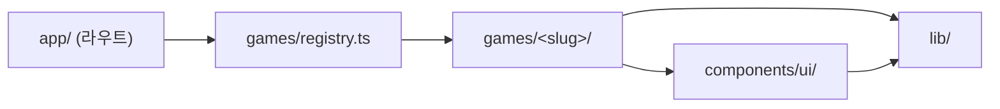

# 아키텍처

소규모 프로젝트를 전제로 **최소한의 레이어**만 둔다. 추상화는 실제로 두 번 이상 필요해졌을 때 도입한다.

## 실행 환경

- 진행자 노트북(데스크톱 브라우저, 1920×1080 기준) → 프로젝터/TV 출력
- 참가자 기기 연동 없음, 서버 상태 없음, 네트워크가 끊겨도 게임 진행 가능해야 함
- 모든 게임 페이지는 빌드 시 정적으로 생성된다 (`generateStaticParams`). `cacheComponents` 환경이라 `dynamicParams`는 쓸 수 없으며, 미등록 slug는 `notFound()`로 not-found UI를 보여준다 (스트리밍 특성상 상태 코드는 200일 수 있음)

## 디렉터리 구조

```text
yos-game/
├── app/                      # 라우팅 전용 (얇게 유지)
│   ├── layout.tsx            # 루트 레이아웃 (lang="ko", 전역 배경)
│   ├── page.tsx              # 홈: 레지스트리 기반 게임 목록
│   ├── not-found.tsx         # 404 화면 (미등록 slug 포함)
│   ├── globals.css           # Tailwind 진입점 + 테마 토큰
│   └── games/[slug]/page.tsx # 게임 공통 셸: 헤더 + 레지스트리에서 찾은 게임 렌더
├── games/                    # 게임 모음 (기능 단위 폴더)
│   ├── types.ts              # GameMeta 타입
│   ├── registry.ts           # 게임 등록부 (SSOT)
│   └── <slug>/               # 게임 1개 = 폴더 1개
│       ├── meta.ts           # 제목·설명·인원 등 메타데이터
│       ├── logic.ts          # 순수 함수: 규칙, 상태 전이 (React 의존 X)
│       └── Game.tsx          # "use client" 게임 UI (진입 컴포넌트, default export)
├── components/ui/            # 2개 이상 게임이 쓰는 공용 UI (Button 등)
├── lib/                      # 공용 유틸 (cn 등), 공용 훅은 lib/hooks/
├── e2e/                      # Playwright 테스트 (*.spec.ts)
├── docs/                     # 하네스 문서
└── public/                   # 정적 에셋 (게임별 에셋은 public/games/<slug>/)
```

## 의존 방향



- 화살표 반대 방향 import 금지 (예: `components/`가 `games/`를 import 하면 안 됨)
- `games/<a>/`가 `games/<b>/`를 import 하는 것 금지 → 공용 코드는 `components/` 또는 `lib/`로 이동
- 모든 import는 `@/` 절대 경로 사용 (같은 게임 폴더 내부는 `./` 상대 경로 허용)

## 서버/클라이언트 컴포넌트 경계

- `app/` 아래 페이지·레이아웃은 **서버 컴포넌트**로 유지 (메타데이터, 정적 생성)
- 상호작용이 있는 게임 UI(`Game.tsx`)와 그 하위만 `"use client"`
- `logic.ts`는 어느 쪽에서도 쓸 수 있는 순수 TS

## 상태 관리

- 게임 상태는 각 `Game.tsx`의 `useState` / `useReducer`로 로컬 관리 (전역 상태 라이브러리 없음)
- 상태 전이 함수는 `logic.ts`에 두어 `useReducer`의 reducer로 그대로 쓸 수 있게 한다
- 새로고침 후에도 유지해야 하는 값(점수판 등)만 `localStorage` 사용 — 키는 `yos-game:<slug>:<key>` 형식

## 하지 않는 것 (현 단계)

- 백엔드(Route Handler / Server Action / DB / 인증)
- 상태 관리 라이브러리, CSS-in-JS, UI 컴포넌트 라이브러리
- 단위 테스트 프레임워크 (필요해지면 Vitest 도입을 검토)

이 목록의 항목이 필요해지면 문서를 먼저 갱신하고 사용자와 합의한다.
